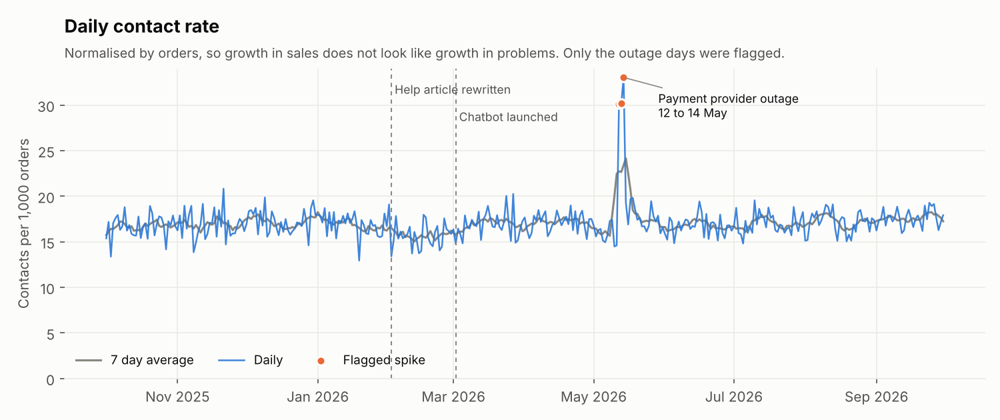
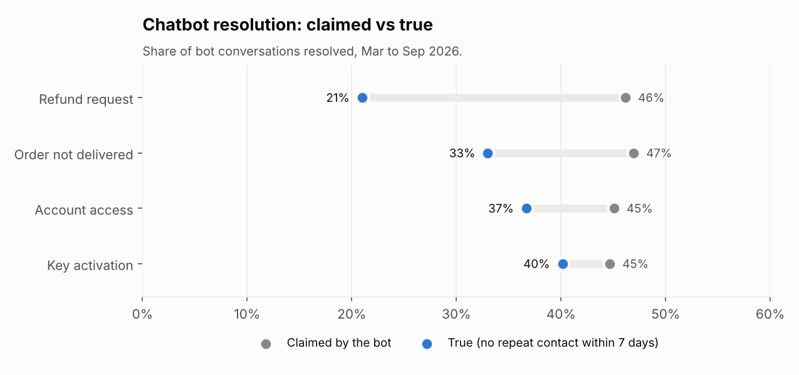
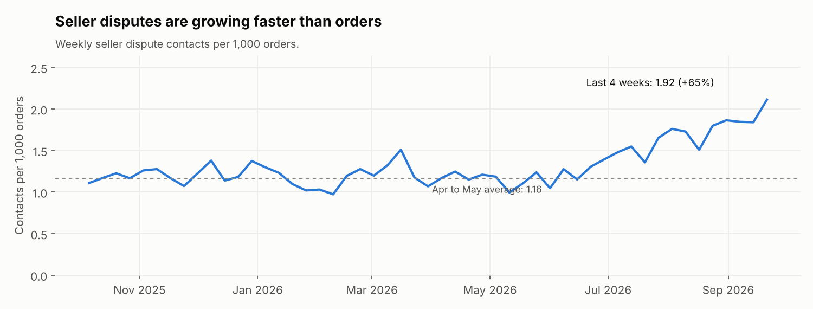
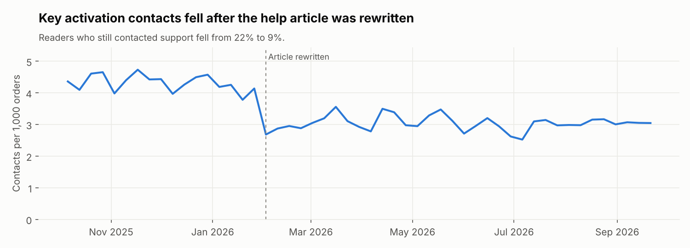
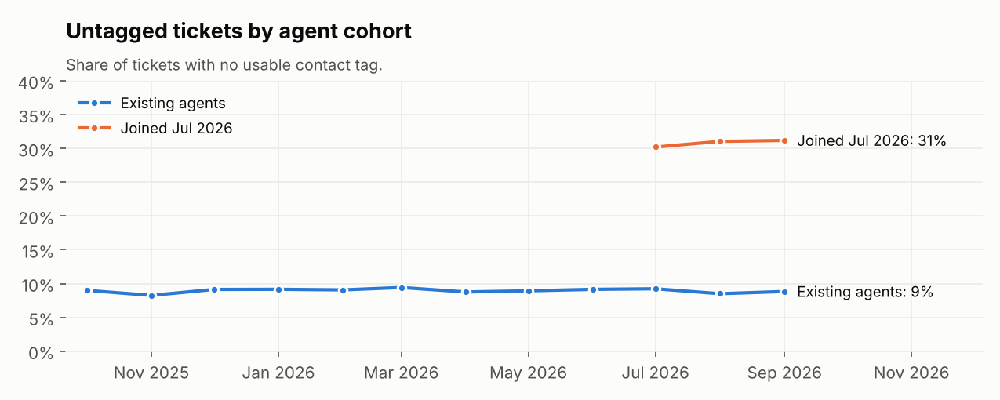
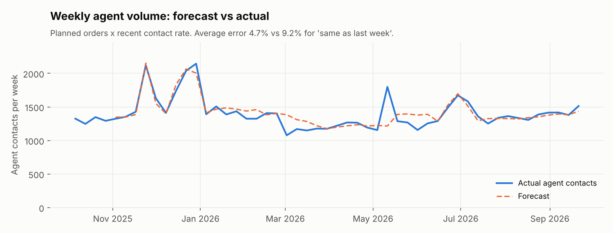
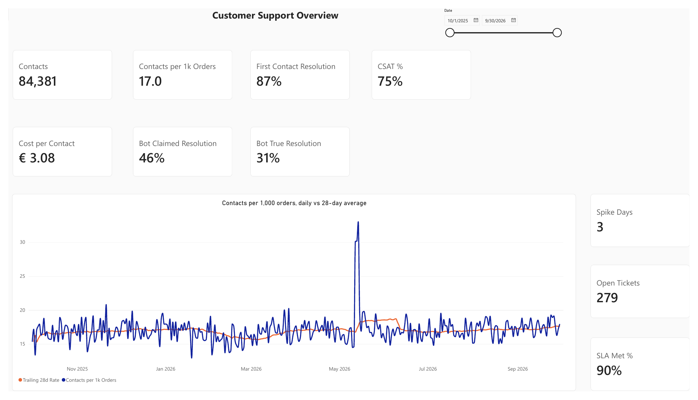
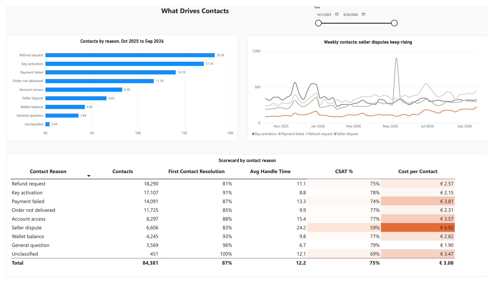
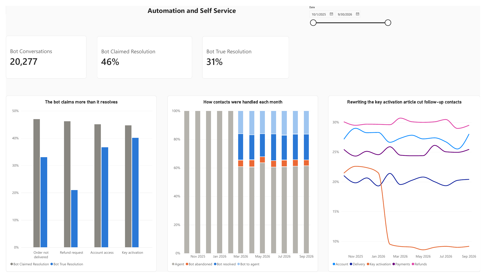
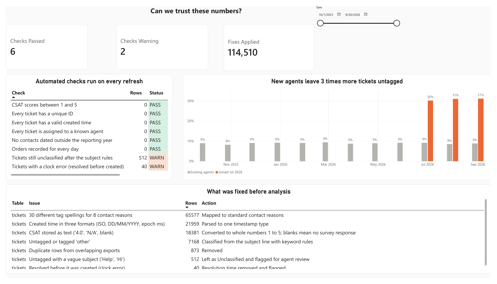

# Customer Support Analytics Pipeline

Why do customers contact us, what do self-service and automation really resolve, and what should we fix first?

This project answers those questions for a fictional digital games marketplace (game keys, gift cards and in-game currency from many sellers), using one year of synthetic helpdesk, chatbot, order and help centre data. I built every layer myself: cleaning messy exports, a tagging audit with text classification, SQL metric tables, a volume forecast with a capacity estimate, and an automated weekly support pack for operations managers.



## What it found

| Finding | Evidence | Recommended action |
| --- | --- | --- |
| **A payment provider outage flooded support** | Contacts hit 31.1 per 1,000 orders against a normal 17.2 for three days. First response SLA fell from 91% to 79%, CSAT from 75% to 57%, and the backlog peaked at 279 open tickets (normal: 115). The daily alert flagged exactly those 3 days and nothing else all year. | Agree an incident playbook with Payments: a status banner and a macro reply as soon as the alert fires. |
| **The chatbot's resolution rate is overstated** | The bot marked 46% of conversations resolved, but only 31% were truly resolved (no repeat contact within 7 days). For refunds: 46% claimed, 21% true. Cost per contact fell from €3.39 to €2.89, but contacts per 1,000 orders did not fall (16.7 before launch, 17.2 after). | Report true resolution, not the bot's own flag. Hand refund intents to agents, or fix the refund flow, before expanding the bot. |
| **A better help article genuinely prevented contacts** | After the key activation article was rewritten, readers who still contacted support fell from 22% to 9%, and key activation contacts fell from 4.32 to 2.85 per 1,000 orders. | Apply the same rewrite to the refunds article, which has the highest contact after reading rate (30%). |
| **Seller disputes are a growing issue** | Up 65% per 1,000 orders since spring (1.16 to 1.92). They are the most expensive contact (€6.92 vs €3.08 average) with the lowest CSAT (59%). | Share the top disputes with the Marketplace team and track the rate weekly. |
| **New agents are not tagging tickets** | 31% of tickets from agents who joined in July are untagged, against 9% for existing agents. | A short tagging refresher; until then, the subject line classifier fills most gaps. |
| **Volume can be planned** | Planned orders × recent contact rate forecasts weekly agent volume with a 4.7% average error, against 9.2% for "same as last week". Next week needs about 1,459 agent contacts, or 12 full time agents. | Use the forecast for weekly rota planning. |

| Chatbot: claimed vs true resolution | Seller disputes growing |
| --- | --- |
|  |  |
| **Help article effect** | **Tagging audit** |
|  |  |



## Scorecard by contact reason

| Contact reason | Contacts | First contact resolution | Avg handle time | CSAT | Cost per contact |
| --- | --- | --- | --- | --- | --- |
| Refund request | 18,290 | 81% | 11.1 min | 75% | €2.57 |
| Key activation | 17,107 | 91% | 8.8 min | 78% | €2.15 |
| Payment failed | 14,091 | 87% | 13.3 min | 74% | €3.81 |
| Order not delivered | 11,725 | 85% | 9.9 min | 77% | €2.31 |
| Account access | 8,297 | 88% | 15.4 min | 77% | €3.57 |
| Seller dispute | 6,606 | 83% | 24.2 min | 59% | €6.92 |
| Wallet balance | 4,245 | 93% | 9.8 min | 77% | €2.82 |
| General question | 3,569 | 96% | 6.7 min | 79% | €1.90 |

Contacts include chatbot conversations. Cost per contact includes bot conversations at €0.25 each, which is why reasons the bot handles look cheaper.

## How the metrics are defined

Clear definitions matter more than clever formulas, so every metric is defined once, in SQL:

* **Contact:** one customer reaching out, by agent ticket or chatbot. A bot chat handed to an agent is one contact, not two.
* **Contacts per 1,000 orders:** the main volume measure. It separates "more customers" from "more problems".
* **Repeat contact:** the same customer contacting about the same reason within 7 days.
* **First contact resolution (FCR):** share of contacts with no repeat contact within 7 days.
* **True bot resolution:** the bot marked the chat resolved *and* the customer did not come back within 7 days.
* **First response SLA:** chat answered within 5 minutes, email and web form within 24 hours.
* **CSAT:** share of survey responses rating 4 or 5.
* **Spike:** a day 40% above its trailing 28 day contact rate, or a reason's week 50% above its trailing 8 week rate.

## Power BI dashboard

I built a four-page Power BI report on the pipeline's metric tables ([PDF](data/powerbi/Customer_support.pdf)). It uses a star schema with a shared Dates table, measures that recalculate rates from their parts (never summing or averaging rates), and a date slicer synced across pages.

| Page | Question it answers |
| --- | --- |
| Overview | How is support doing? Contacts per 1,000 orders against its 28-day average, SLA, CSAT, open tickets and spike days. |
| Drivers | What causes contacts, and which hurt most? A scorecard by reason, with cost and CSAT highlighted. |
| Automation and self-service | Does the bot really resolve contacts? Claimed vs true resolution, how contacts were handled each month, and the help article rewrite. |
| Data quality | Can we trust the numbers? Automated checks, the cleaning log and the tagging audit. |







## How it works

```
Helpdesk export  ─┐
Chatbot logs      ─┼─> clean ─> tagging audit ─> quality checks ─> SQL metrics ─> forecast + weekly pack
Orders            ─┤                               (a FAIL stops the run)
Help centre       ─┘
```

| Step | File | What happens |
| --- | --- | --- |
| Clean | `pipeline/clean.py` | Removes 873 duplicate rows from overlapping exports, parses three timestamp formats, fixes CSAT stored as text, flags 40 clock errors, and maps 30 tag spellings to 8 contact reasons. Every fix is logged. |
| Tagging audit | `pipeline/clean.py` | 7,168 tickets had no usable tag. Keyword rules on the subject line classify them; on tagged tickets the rules never contradicted the agent's tag, and the 7% of subjects too vague to classify ("Help", "Hi") are left for agent review. |
| Validate | `pipeline/quality.py` | Eight checks. WARN results are reported; a FAIL stops the run so no report is built on broken data. |
| Metrics | `models/marts/*.sql` | SQL models in DuckDB: a single contact table, daily operations pulse, weekly drivers with spike flags, bot deflection, scorecard, help centre, tagging audit and cost. Standard SQL that ports to Databricks or any warehouse. |
| Analyse | `analysis.py` | Charts, the forecast and capacity estimate, and the weekly support pack. |
| Report | `reports/` | Two generated weekly packs: [the outage week](reports/weekly_support_pack_2026-05-11.md) and [the latest week](reports/weekly_support_pack_2026-09-21.md). |
| BI exports | `data/powerbi/` | Every metric table as CSV, ready for QuickSight, Power BI or Looker. |

## Run it

```bash
pip install -r requirements.txt
python scripts/generate_sample_data.py   # one year of messy sample exports in data/raw
python run_pipeline.py                   # clean, check, build the metric tables
python analysis.py                       # charts, forecast and weekly packs
```

## A note on the data

All data is synthetic, generated by `scripts/generate_sample_data.py` to behave like real helpdesk and chatbot exports, including their problems. The company is fictional and no real customer data is used. The generator also writes `_answer_key_true_reasons.csv` so the tagging classifier can be scored; the pipeline itself never reads it.

## Tech

Python (pandas, matplotlib), SQL on DuckDB.
